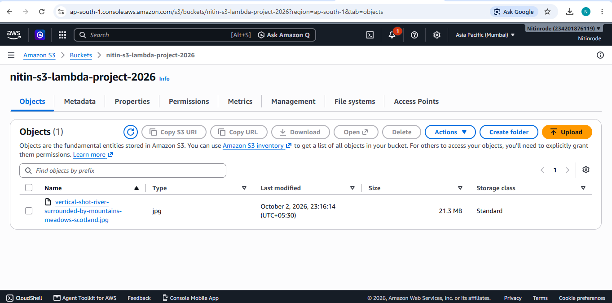
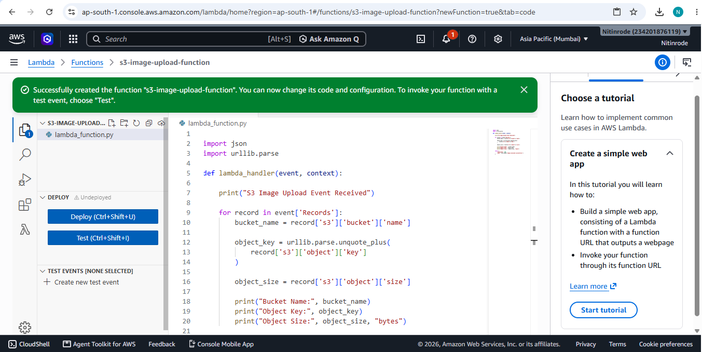
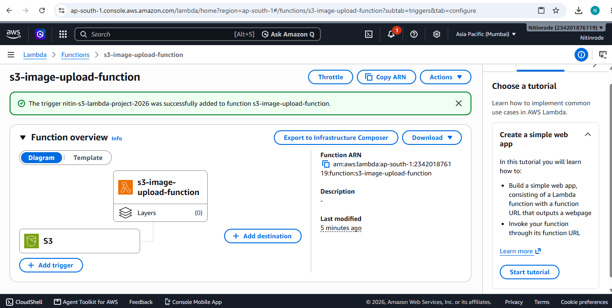
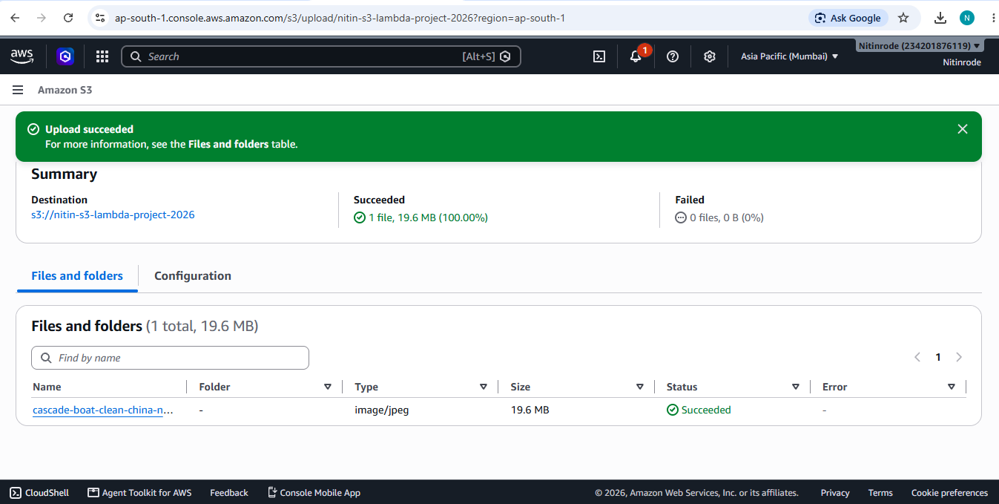
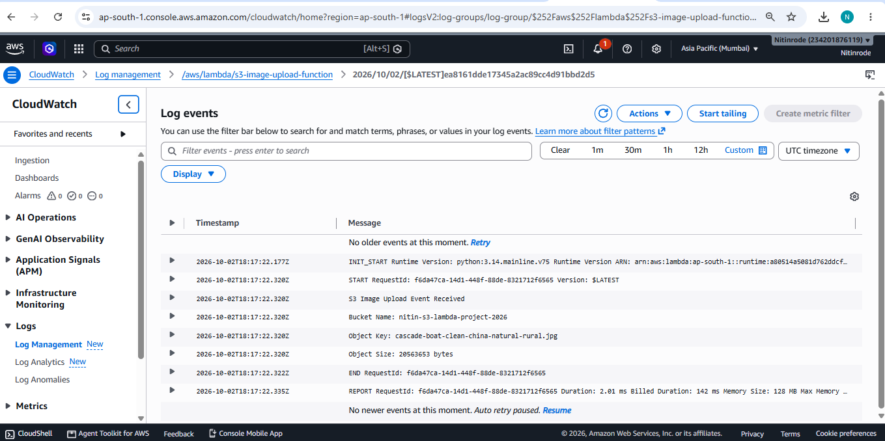

# AWS Project 1 – Serverless Image Upload using S3 and Lambda

## 1. Project Overview

This project demonstrates a simple **serverless image upload workflow** using AWS services.

When a user uploads an image to an Amazon S3 bucket, the upload automatically generates an **S3 Object Created event**. This event triggers an AWS Lambda function. The Lambda function reads the uploaded object's details and prints them in **Amazon CloudWatch Logs**.

### Main Architecture

**User → S3 Bucket → S3 Event → Lambda → CloudWatch**

The project demonstrates how AWS services can work together automatically without using a traditional server.

---

## 2. AWS Services Used

| AWS Service | Purpose |
|---|---|
| **Amazon S3** | Stores the uploaded image |
| **AWS Lambda** | Automatically processes the S3 upload event |
| **Amazon CloudWatch** | Stores and displays Lambda execution logs |
| **AWS IAM** | Provides required permissions between AWS services |

---

## 3. Architecture Diagram


### Architecture Flow

1. **User** uploads an image.
2. The image is stored in the **S3 bucket**.
3. S3 generates an **Object Created event**.
4. The event automatically invokes the **Lambda function**.
5. Lambda extracts the:
   - Bucket Name
   - Object Key / File Name
   - Object Size
6. Lambda prints these details to **CloudWatch Logs**.

---

## 4. S3 Bucket Configuration

### Bucket Details

- **Bucket Name:** `nitin-s3-lambda-project-2026`
- **Region:** `ap-south-1` (Asia Pacific – Mumbai)
- **Purpose:** Store uploaded image files

An image was uploaded to the bucket to test the event-driven workflow.

Example image:

```text
cascade-boat-clean-china-natural-rural.jpg
```

---

## 5. Lambda Function

### Function Details

- **Function Name:** `s3-image-upload-function`
- **Runtime:** Python 3.14
- **Architecture:** x86_64
- **Purpose:** Process the S3 upload event and extract object details

### Lambda Code

```python
import json
import urllib.parse

def lambda_handler(event, context):
    print("S3 Image Upload Event Received")

    for record in event['Records']:
        bucket_name = record['s3']['bucket']['name']

        object_key = urllib.parse.unquote_plus(
            record['s3']['object']['key']
        )

        object_size = record['s3']['object']['size']

        print("Bucket Name:", bucket_name)
        print("Object Key:", object_key)
        print("Object Size:", object_size, "bytes")

    return {
        'statusCode': 200,
        'body': json.dumps('Image processed successfully!')
    }
```

### What the Lambda Function Does

The function receives the S3 event and extracts three important values:

- **Bucket Name** – identifies the S3 bucket.
- **Object Key** – identifies the uploaded file.
- **Object Size** – shows the file size in bytes.

The extracted information is printed using `print()` and appears in CloudWatch Logs.

---

## 6. S3 Event Trigger

The S3 bucket was connected to the Lambda function using an S3 event notification.

### Trigger Configuration

- **Source:** Amazon S3
- **Bucket:** `nitin-s3-lambda-project-2026`
- **Event Type:** All object create events
- **Prefix:** None
- **Suffix:** None

Whenever a new object is created in the bucket, S3 automatically invokes the Lambda function.

---

## 7. CloudWatch Logs

Lambda execution logs are available in the following CloudWatch log group:

```text
/aws/lambda/s3-image-upload-function
```

### Example Log Output

```text
S3 Image Upload Event Received
Bucket Name: nitin-s3-lambda-project-2026
Object Key: cascade-boat-clean-china-natural-rural.jpg
Object Size: 20563653 bytes
```

### Lambda Execution Details

CloudWatch also records execution information such as:

```text
Duration: 2.01 ms
Billed Duration: 142 ms
Memory Size: 128 MB
Max Memory Used: 39 MB
Init Duration: 139.05 ms
```

These details confirm that the Lambda function was successfully executed.

---

## 8. Testing and Result

### Test

A new image was uploaded to the S3 bucket:

```text
cascade-boat-clean-china-natural-rural.jpg
```

After the upload:

**S3 → Object Created Event → Lambda → CloudWatch Logs**

### Result

The Lambda function successfully detected:

- Bucket name
- Uploaded file name
- Object size

The execution details and output were successfully recorded in CloudWatch.

Therefore, the **S3 + Lambda + CloudWatch serverless workflow was successfully implemented and tested.**

---

## 9. Screenshots

## Submission Evidence 

### 1. S3 Bucket creation


### 2. S3 Image upload


### 3. Lambda Function Code


### 4. Lambda Trigger


### 5. Test Image


### 6. Image Uploaded to S3



### 7. CloudWatch Execution



## 10. Project Structure

```text
Project-1-S3-Lambda/
│
├── README.md
├── architecture-diagram.png
│
└── screenshots/
    ├── 01-s3-bucket.png
    ├── 02-image-upload.png
    ├── 03-lambda-code.png
    ├── 04-s3-lambda-trigger.png
    ├── 05-s3-new-image.png
    |-- 06-image-uploaded-to-S3
    └── 07-cloudwatch-logs.png
```

---

## 11. Key Concepts Learned

- Amazon S3 bucket and object storage
- S3 event notifications
- AWS Lambda functions
- Event-driven serverless architecture
- Lambda execution logs
- Amazon CloudWatch monitoring
- Basic AWS IAM permissions
- Testing an AWS serverless workflow

---

## 12. Conclusion

This project successfully implements an **event-driven serverless image upload system** using Amazon S3, AWS Lambda, and Amazon CloudWatch.

When an image is uploaded to S3, the event automatically triggers Lambda. Lambda extracts the uploaded object's details and records the execution information in CloudWatch.

This project demonstrates a practical use of **AWS serverless architecture and event-driven processing**.
